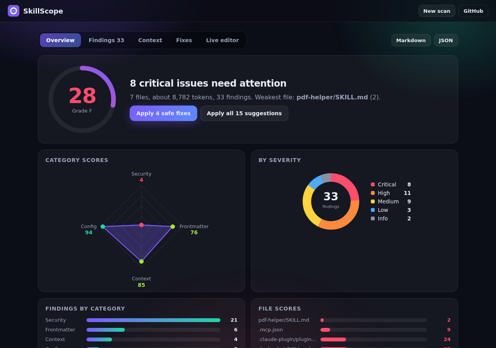

<div align="center">

# SkillScope

**Lint your agent skills, plugins and MCP configs before your agent trusts them.**

Prompt injection. Hidden characters. Leaked secrets. Bloated context. Broken frontmatter.
One command in the terminal, one animated report in the browser, one click to fix.

[**Live demo**](https://delevski.github.io/skillscope/) &nbsp;|&nbsp; [Demo video](docs/demo.mp4) &nbsp;|&nbsp; [Install](#install) &nbsp;|&nbsp; [Rules](#what-it-checks) &nbsp;|&nbsp; [License](LICENSE)



</div>

## Why

Agent skills (`SKILL.md`), plugin manifests and MCP server configs are text your agent reads and obeys. A single line such as "ignore previous instructions", a zero-width character, a hook that pipes `curl` into `sh`, or an API key pasted into `.mcp.json` can turn a helpful tool into an attack. Large skills also eat the context window before the user types a word.

SkillScope finds these problems fast, shows them in a report you can actually read, and proposes a patch for each one.

## Install

No install needed:

```bash
npx github:delevski/skillscope ./skills
```

Or clone and run:

```bash
git clone https://github.com/delevski/skillscope && cd skillscope
npm install && npm run build
node dist/cli.mjs ./path/to/repo
```

Try it on the fictional sample files in this repo (made-up company "Acme", nothing real):

```bash
npx github:delevski/skillscope examples
npx github:delevski/skillscope --demo --fix --dry-run   # preview every safe fix as a diff
```

## Live preview

Open **https://delevski.github.io/skillscope/** to get the animated report. Paste a file, drop files in, load the demo set, or point it at a public GitHub repo. Everything runs in your browser. Nothing is uploaded anywhere.

- **Overview**: score ring, category radar, severity donut, per-file bars and a findings heatmap
- **Findings**: filter by severity or category, search, expand for the offending line
- **Context**: estimated tokens per file, split into always-loaded frontmatter and on-demand body
- **Fixes**: a diff for every suggestion, apply one, apply all safe ones, or apply all
- **Live editor**: edit a file and watch the score update as you type

## CLI

```text
skillscope [paths...] [options]

  --json              print the full report as JSON
  --fix               apply safe auto-fixes in place
  --fix-all           apply every suggested fix (review the diff first)
  --dry-run           with --fix, print the diff and change nothing
  --fail-on <level>   exit 1 at or above: critical | high | medium | low (default: high)
  --demo              lint the built-in fictional sample files
  --write-demo <dir>  write the fictional samples to a folder
```

It walks directories and picks up `SKILL.md`, `CLAUDE.md`, `AGENTS.md`, `.cursorrules`, `.mdc` rules, `.mcp.json`, `claude_desktop_config.json`, `plugin.json` and `marketplace.json`. It skips `node_modules` and `.git`.

Use it in CI:

```yaml
- run: npx github:delevski/skillscope . --fail-on high
```

## What it checks

| Area | Examples |
| --- | --- |
| **Security** | instruction override phrases, "do not tell the user", role hijacks, system prompt leaks, secrets sent over `curl`, `curl \| sh`, credential file reads, hidden Unicode (zero-width, bidi, tag characters), instructions hidden in HTML comments, long base64 blobs, `Bash(*)` and other wildcard tool grants, disabled safety flags |
| **Frontmatter** | missing or unclosed block, missing `name` or `description`, name not kebab-case, name not matching the folder, description too short or too long, invalid YAML, unknown keys |
| **Context** | files above 4k and 9k estimated tokens, repeated paragraphs, ALL-CAPS shouting, extremely long lines, giant inline code blocks |
| **MCP and plugin config** | invalid JSON, servers that cannot start, hardcoded API keys and tokens, plain HTTP URLs, shell launchers (`bash -c`), unpinned `npx` packages, filesystem root access, hooks that download or exfiltrate, non-semver versions |

Each finding has a severity (`critical`, `high`, `medium`, `low`, `info`) and many carry a fix. **Safe** fixes are mechanical (strip hidden characters, kebab-case the name, switch to HTTPS). **Review** fixes delete or rewrite content, so you see the diff first.

Token counts are estimates (characters divided by four). Pattern rules are heuristics, so treat a hit as a prompt to look, not a verdict.

## Project layout

```text
src/core      rule engine, fixer, scoring (shared by the CLI and the web app)
src/cli       command line entry point (bundled to dist/cli.mjs)
web           React + Vite report UI (deployed to GitHub Pages)
examples      fictional sample files with planted problems
test          Vitest suite for the rules and fixes
```

```bash
npm run dev        # web app with hot reload
npm test           # rule tests
npm run build      # CLI bundle + static site
```

## Contributing

Rules live in `src/core/rules`. Add a pattern, add a test in `test/core.test.ts`, run `npm test`. Pull requests that add new rules with a fixture are very welcome.

## License

MIT. Copyright (c) 2026 Or Delevski.
